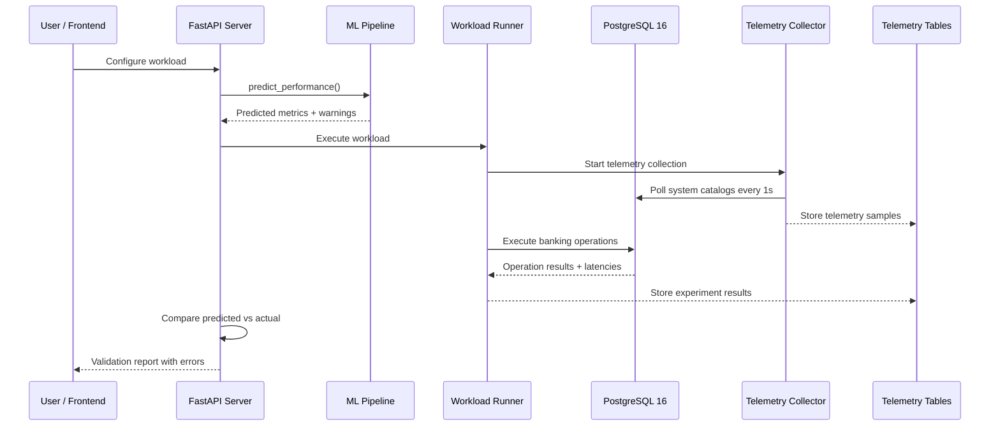

# FinTwin v7.0.0 — Technical Review Report

**Project:** FinTwin — AI-Powered Banking Database Performance Simulator & Digital Twin  
**Stack:** Python 3.11+ · PostgreSQL 16 · FastAPI · SQLAlchemy 2.x · scikit-learn · Vanilla JS  
**Date:** 25 September 2026

---

## 1. Executive Audit & System Architecture

### What is FinTwin?

FinTwin is a **Performance Digital Twin** — a system that learns how a PostgreSQL database behaves under different banking workloads so it can *predict* future performance without running the actual workload. It is **not** a business-logic simulator or an operational replica. Its scope is strictly: *"If I send X transactions per second at Y concurrency, what latency/CPU/throughput should I expect?"*

The system works in a closed loop:

1. **Generate** synthetic banking transactions against a real PostgreSQL database
2. **Observe** how the database responds (latency, CPU, locks, throughput)
3. **Learn** the relationship between workload settings and outcomes using ML
4. **Predict** performance for new configurations without running them
5. **Validate** predictions by running the workload and comparing

### Architecture Diagram



### Why This Tech Stack?

| Choice | Reasoning |
|--------|-----------|
| **PostgreSQL 16** | Rich system catalog views (`pg_stat_activity`, `pg_locks`) enable deep performance introspection |
| **SQLAlchemy 2.x Core** | Raw SQL via `text()` gives precise control — important for a benchmarking system |
| **FastAPI** | Modern Python API framework with automatic validation via Pydantic v2 |
| **scikit-learn** | Interpretable models (Linear Regression, Random Forest, Gradient Boosting) — appropriate for a learning project |
| **Vanilla JS** | Zero build tools = no npm/Webpack complexity, instant page loads, no supply chain risk |

---

## 2. Database Architecture & Relational Integrity

### Schema Overview

The database has **6 business tables** in Third Normal Form (3NF) and **4 telemetry tables**:

| Table | Rows | Key Constraints |
|-------|:----:|-----------------|
| `branches` | 100 | Unique `branch_code` and `ifsc_code`, non-empty checks |
| `customers` | 1,000 | FK → branches, unique email/phone, gender and KYC enums |
| `accounts` | 1,500 | FK → customers + branches, `balance >= 0`, `currency = 'INR'`, status-date coherence |
| `merchants` | 100 | Status enum, MCC codes |
| `transactions` | 5,000 | `amount > 0`, shape constraint enforcing correct fields per transaction type |
| `loans` | 200 | FK → customers + accounts + branches, `end_date > start_date`, positive principal |

The `transactions_shape_ck` constraint is particularly well-designed — it enforces that a `TRANSFER` must have both `from_account_id` and `to_account_id`, a `DEPOSIT` must have `to_account_id`, etc. This prevents structurally invalid records at the database level.

### Deadlock Prevention

The most critical piece of engineering is in [`transfer_funds()`](file:///C:/Users/arrav/Desktop/FinTwin/backend/app/services/transfer_service.py). When two users transfer money simultaneously ($A → B$ and $B → A$), a deadlock can occur if they lock accounts in different orders.

**The solution** (line 30):
```python
first_id, second_id = sorted((source_account_id, destination_account_id))
```

By always locking accounts in ascending ID order, both transactions try to lock the smaller ID first. This creates a consistent ordering that makes deadlocks **mathematically impossible** — the wait-for graph can never form a cycle.

### ACID Compliance

| Property | How It's Achieved |
|----------|-------------------|
| **Atomicity** | `engine.begin()` wraps the entire transfer; exceptions trigger automatic rollback |
| **Consistency** | `CHECK (balance >= 0)` + application-level balance check = defense in depth |
| **Isolation** | `SELECT ... FOR UPDATE` row-level locks prevent concurrent modifications |
| **Durability** | PostgreSQL WAL + Docker named volume persists data across restarts |

### Indexing

12 indexes cover all foreign keys, timestamp ranges, and telemetry lookups. The composite index `idx_telemetry_samples_experiment_time` on `(experiment_id, captured_at)` efficiently supports time-series queries.

---

## 3. Workload Generation & Simulation

### 7 Banking Scenarios

Each scenario defines a probability distribution over 7 operation types:

| Scenario | Dominant Operations | Real-World Analog |
|----------|--------------------|--------------------|
| `NORMAL_DAY` | Balance checks 35%, Transfers 20% | Typical weekday |
| `SALARY_DAY` | Deposits 35%, Balance checks 25% | Month-end salary credits |
| `FESTIVAL_SPIKE` | Payments 40%, Balance checks 25% | Diwali/holiday shopping |
| `HIGH_CONCURRENCY_TRANSFER` | Transfers 70% | Stress test for lock contention |

### How Pacing Works

The runner calculates when each operation *should* be submitted based on the target TPS:

```python
target_offset = index / self.config.target_tps  # When operation #i should fire
remaining = target_offset - (perf_counter() - started_clock)
if remaining > 0:
    time.sleep(remaining)  # Wait until the right moment
```

**Target TPS** is what you ask for. **Actual TPS** is what the database delivers (`completed_operations / elapsed_time`). When the database saturates, actual TPS falls below target — this gap measures system capacity.

### Timing Isolation

Latency is measured **inside** each worker thread using `perf_counter()`, wrapping only the database operation — not the pacing sleep. This ensures clean, uncontaminated latency measurements.

---

## 4. Telemetry Engine

### What Gets Collected

A background daemon thread polls PostgreSQL every 1 second, gathering:

| Source | Metrics |
|--------|---------|
| `pg_stat_activity` | Active, idle, waiting, and blocked connections |
| `pg_stat_database` | Transaction commits/rollbacks, buffer cache hits/reads, deadlocks |
| `pg_locks` | Total locks, non-granted (waiting) locks |
| `pg_database_size()` | Database size in bytes |
| `psutil` (Python) | Host CPU and memory utilization |

Cache hit ratio is computed as: $\frac{\text{blks\_hit}}{\text{blks\_hit} + \text{blks\_read}} \times 100$

### Important Limitation

The `psutil` metrics measure the **entire host machine**, not just PostgreSQL. Other running processes contribute to CPU/memory readings, which means trained models are tied to the specific machine they were trained on.

---

## 5. Machine Learning Pipeline

### Feature Engineering

**Input features** (what the model sees — all known *before* the experiment runs):
- Scenario (one-hot encoded, 7 categories)
- Concurrency, target TPS, duration, burstiness
- 7 operation mix ratios (balance_check_ratio, transfer_ratio, etc.)

**Target outputs** (what the model predicts):
- Average latency (ms), P95 latency (ms), actual TPS, host CPU (%), max lock waits

### Data Leakage Prevention

The `ColumnTransformer` uses `remainder="drop"`, meaning **only** the pre-configured features pass through. Runtime observations (actual TPS, latency, CPU) are never used as inputs — they are strictly targets. This guarantees zero data leakage.

### Training & Model Selection

Three models compete for each target: Linear Regression, Random Forest, and Gradient Boosting. The best model per target is selected by lowest MAE (Mean Absolute Error), using `GroupShuffleSplit` to prevent train/test contamination across identical configurations.

**Empirical results** (8 experiments, 7 usable):

| Target | Best Model | MAE | R² |
|--------|------------|:---:|:---:|
| Average Latency | Gradient Boosting | 2.52 ms | -0.19 ⚠️ |
| P95 Latency | Linear Regression | 1.04 ms | 0.27 |
| Actual TPS | Linear Regression | 0.35 TPS | **0.99** ✅ |
| Host CPU | Gradient Boosting | 2.66% | 0.59 |
| Lock Waits | Linear Regression | 0.0 | 1.00 |

The negative R² on latency means the model performs **worse than just predicting the average** — a direct consequence of having only 7 training samples.

### OOD Detection

When a prediction request has feature values outside the training range, warnings are generated:
> *"concurrency=50 is outside the training range 4–12"*

---

## 6. What-If Analysis

The what-if engine compares two workload configurations **without executing either one**:

$$\Delta_{\%} = \frac{y_{\text{modified}} - y_{\text{baseline}}}{|y_{\text{baseline}}|} \times 100$$

Results are categorized as:
- **HIGH_IMPACT** — any metric changes ≥ 20%
- **MEDIUM_IMPACT** — any metric changes ≥ 5%
- **LOW_IMPACT** — all metrics change < 5%

**Sensitivity analysis** sweeps one parameter (e.g., concurrency from 25 to 100) and computes the model-derived gradient $\frac{\Delta y}{\Delta x}$ — the predicted change in performance per unit change in the parameter.

**Important caveat:** These are model correlations, not proven causal relationships. The system is transparent about this distinction.

---

## 7. Optimization Engine

Six rule-based checks detect bottlenecks from measured experiment data:

| Rule | Trigger Condition | Severity |
|------|-------------------|----------|
| CPU pressure | CPU ≥ 80% | HIGH |
| Memory pressure | Memory ≥ 85% | HIGH |
| Connection saturation | Active / Max ≥ 80% | HIGH |
| Lock contention | Any ungranted locks | HIGH |
| Tail latency spike | P95 / Average ≥ 2.0× | MEDIUM |
| Poor cache behavior | Cache hit ratio < 95% | MEDIUM |

Each recommendation includes structured evidence, a recommended action, and a `requires_validation: true` flag. The engine is **strictly advisory** — it never modifies the database or configuration automatically.

When `pg_stat_statements` is unavailable (common in Docker), the engine degrades gracefully with a clear warning rather than crashing or fabricating query-level analysis.

---

## 8. Validation & Accuracy

### The Validation Loop

1. Predict performance for a workload configuration
2. Execute the same workload against real PostgreSQL
3. Capture actual telemetry
4. Compute errors between predicted and actual values

### Error Metrics

$$\text{MAE} = \frac{1}{n}\sum|predicted - actual| \qquad \text{RMSE} = \sqrt{\frac{1}{n}\sum(predicted - actual)^2}$$

$$R^2 = 1 - \frac{\sum(predicted - actual)^2}{\sum(actual - \overline{actual})^2} \qquad \text{MAPE} = \frac{1}{n}\sum\frac{|predicted - actual|}{|actual|} \times 100$$

Division by zero is handled safely — when actual = 0, percentage error returns `None`.

### Empirical Validation Results

| Metric | Predicted | Actual | Error |
|--------|:---------:|:------:|:-----:|
| Average Latency | 9.46 ms | 18.83 ms | **49.75%** |
| P95 Latency | 13.30 ms | 39.73 ms | **66.52%** |
| Throughput | 12.15 TPS | 10.08 TPS | 20.57% |
| Host CPU | 13.13% | 26.55% | **50.54%** |
| Lock Waits | 0 | 0 | 0% |

**Why are errors so high?** Three reasons:
1. **Only 7 training samples** — far too few for reliable regression
2. **Tail latency (P95) is inherently harder** to predict — it depends on rare contention events
3. **The model systematically underestimates** because training data came from lower-load runs

The standalone benchmark script (`run_benchmark.py`) provides model-independent ground truth, which is critical when ML models are undertrained.

---

## 9. Frontend

The frontend is **three files with zero external dependencies**:

- `index.html` (2.9 KB) — semantic HTML5 with ARIA accessibility attributes
- `styles.css` (25 KB) — full dark/light theme via CSS custom properties
- `app.js` (36 KB) — single-page app with inline SVG chart rendering

**Key design decisions:**
- Loading states show CSS skeleton animations (never fake data)
- Empty states explain *why* data is missing with actionable text
- Error states display the actual API error (HTML-escaped for safety)
- The `number()` helper returns "—" for null values — never a fabricated zero

---

## 10. Testing & DevOps

### Test Suite

10 test files cover all 7 phases: transfer atomicity, deadlock prevention, TPS pacing, telemetry persistence, ML feature extraction, what-if deltas, optimization thresholds, validation error computation, and API endpoint contracts.

### Docker

PostgreSQL 16 Alpine runs in a container with a named volume for persistence and a `pg_isready` health check (5s interval, 10 retries).

### Deterministic Seeding

`seed_database.py` uses `random.Random(42)` — every run produces identical data, ensuring reproducible experiments.

---

## 11. Limitations

| Limitation | Impact |
|-----------|--------|
| **Only 7 training samples** | Models are statistically unreliable; R² is negative for latency |
| **Uniform account selection** | Real banks have Zipfian distributions (80% of traffic hits 20% of accounts) — FinTwin underestimates hot-spot contention |
| **Host-level CPU metrics** | Trained models are tied to the specific machine; predictions don't transfer across hardware |
| **No query plan analysis** | System cannot detect slow sequential scans or join inefficiencies |
| **`burstiness` parameter unused** | Stored in config but doesn't affect the runner's pacing logic |
| **Synchronous validation endpoint** | Blocks the API server thread for the experiment duration |

---

## 12. Scorecard & Roadmap

### Scorecard

| Dimension | Grade | Key Reasoning |
|-----------|:-----:|---------------|
| Schema & ACID Integrity | **A** | Proven deadlock prevention, sophisticated constraints, proper cascades |
| Concurrency & Simulation | **B+** | Clean pacing mechanics; deducted for uniform selection and unused burstiness |
| Telemetry Collection | **A-** | Comprehensive polling with error resilience; deducted for host-level CPU |
| ML Pipeline Design | **A** | Zero leakage, proper grouped splits, OOD detection |
| Predictive Accuracy | **D+** | Architecturally sound but data-starved; 50–67% validation errors |
| Optimization Engine | **A-** | Structured recommendations with graceful degradation |
| Code & Testing | **A-** | Full phase coverage; deducted for no CI/CD or app Dockerfile |
| Frontend & UX | **A** | Honest state handling, accessible, zero dependencies |

### Future Roadmap

**Phase 8 — Data & Realism:** Run 500+ experiments across a full scenario/concurrency/TPS grid. Add Zipfian account selection and wire the burstiness parameter.

**Phase 9 — Architecture:** Container-aware CPU metrics, query plan integration via `EXPLAIN ANALYZE`, async validation endpoint with background tasks.

**Phase 10 — Advanced ML:** Neural network regressors, prediction confidence intervals, autonomous index validation on shadow databases.

---

## 13. Defense Questions & Answers

**Q1: Prove that `transfer_funds()` prevents deadlocks.**  
Locks are always acquired in ascending `account_id` order via `sorted()`. This total ordering makes the wait-for graph acyclic — cycles (deadlocks) are impossible.

**Q2: How is data leakage prevented?**  
`ColumnTransformer(remainder="drop")` passes only pre-configured features to the model. All runtime metrics are in the `TARGETS` tuple, never in `NUMERIC_FEATURES`.

**Q3: Why is P95 latency error 66.5% when training MAE was only 1.04ms?**  
The training MAE was on similar configurations. The validation hit different contention patterns, and the model extrapolated linearly where real tail latency grows non-linearly.

**Q4: What's the difference between Target TPS and Actual TPS?**  
Target is the intended submission rate (pacing sleep). Actual is measured completions per second. When the database saturates, actual < target — the gap measures overload.

**Q5: Why is `burstiness` stored but unused?**  
It's validated and persisted but the runner's pacing loop doesn't reference it. A correct implementation would use a Weibull or Poisson arrival process modulated by the parameter.

**Q6: What are the risks of `psutil.cpu_percent()`?**  
It measures the entire host, not just PostgreSQL. Other processes contribute noise, and Docker CPU limits are invisible to host-level psutil.

**Q7: How does the optimizer handle missing `pg_stat_statements`?**  
A bare `except` catches the query failure, returns an empty list, and adds a transparent warning. No query-level evidence is fabricated.

**Q8: What would you change for production deployment?**  
Read-only DB user for telemetry, never run synthetic workloads on production (use a replica), container-scoped metrics, async validation endpoint, and automated model retraining on hardware changes.

---

*Report based on complete source-level analysis of the FinTwin v7.0.0 repository.*
